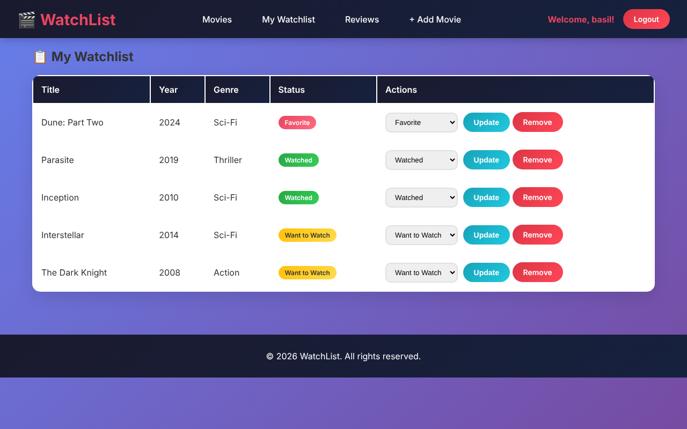
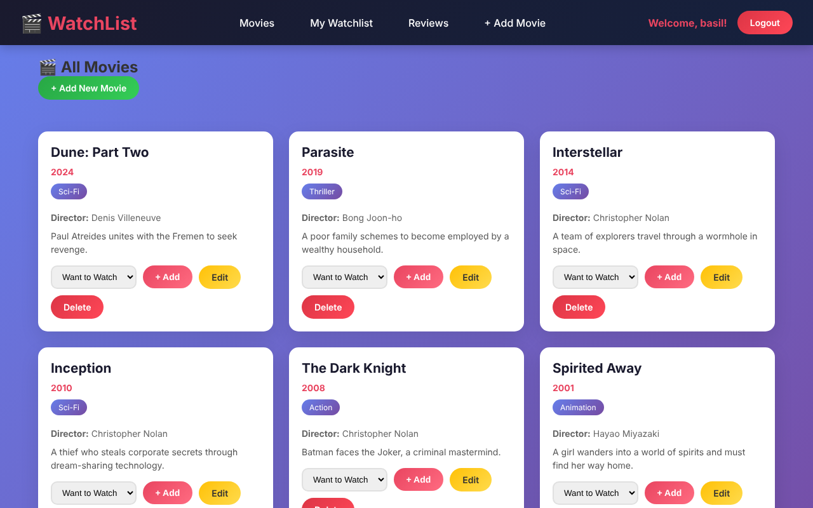
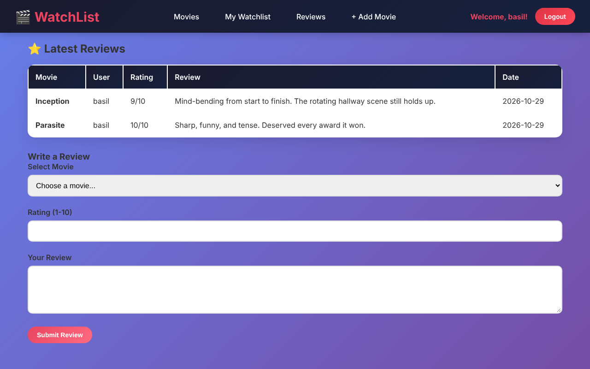
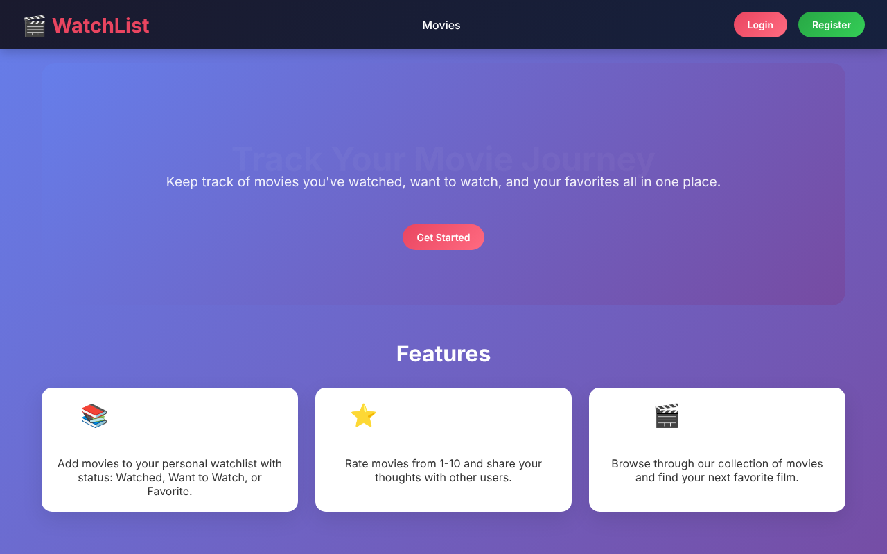
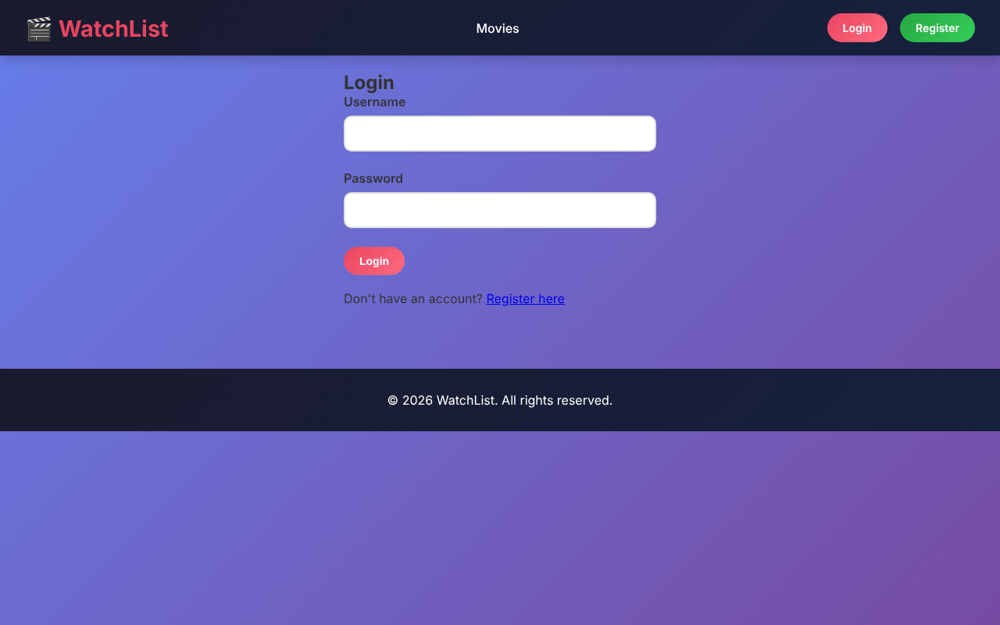

# 🎬 WatchList

A full-stack movie tracking web app built with **Python (Flask)** and **MySQL**. Users create an account, browse a shared movie catalogue, sort films into a personal watchlist, and rate and review what they've watched.



## Features

- **Accounts and login**: register and sign in, with passwords stored as secure hashes (Werkzeug) and sessions to keep users logged in.
- **Movie catalogue**: browse every movie, and add, edit, or delete entries.
- **Personal watchlist**: mark any movie as *Want to Watch*, *Watched*, or *Favorite*, change its status, or remove it. Each user only sees and changes their own list.
- **Ratings and reviews**: rate movies from 1 to 10 and write reviews that everyone can read.
- **Responsive design**: works on desktop, tablet, and phone.

## Screenshots

| Movie catalogue | Reviews |
|---|---|
|  |  |

| Home | Login |
|---|---|
|  |  |

## Tech stack

| Layer | Tools |
|---|---|
| Back end | Python, Flask |
| Database | MySQL (relational schema with foreign keys) |
| Front end | HTML, CSS, Jinja templates |
| Security | Werkzeug password hashing, session-based login, parameterized SQL queries |

## Database design

Four related tables (see [`database.sql`](database.sql)):

- **User**: account details and hashed password
- **Movie**: title, year, genre, director, description
- **Watchlist**: links a user to a movie with a status; a unique key stops the same movie being added twice
- **Review**: a user's 1–10 rating and written review of a movie

Foreign keys with `ON DELETE CASCADE` keep the data consistent when a user or movie is removed.

## Run it locally

You need Python 3.10+ and MySQL installed.

```bash
# 1. Get the code
git clone https://github.com/bzayed888/watchlist.git
cd watchlist

# 2. Create a virtual environment and install packages
python -m venv venv
venv\Scripts\activate        # Windows
# source venv/bin/activate   # macOS / Linux
pip install -r requirements.txt

# 3. Create the database and sample movies
mysql -u root -p < database.sql

# 4. Add your settings
copy .env.example .env       # Windows
# cp .env.example .env       # macOS / Linux
# then open .env and enter your MySQL password and a secret key

# 5. Start the app
python app.py
```

Open http://127.0.0.1:5000 in your browser.

## Author

**Basil Zayed** · Technology Management (IT), Ontario Tech University
[LinkedIn](https://www.linkedin.com/in/basil-zayed-0aab61336/) · [GitHub](https://github.com/bzayed888)
